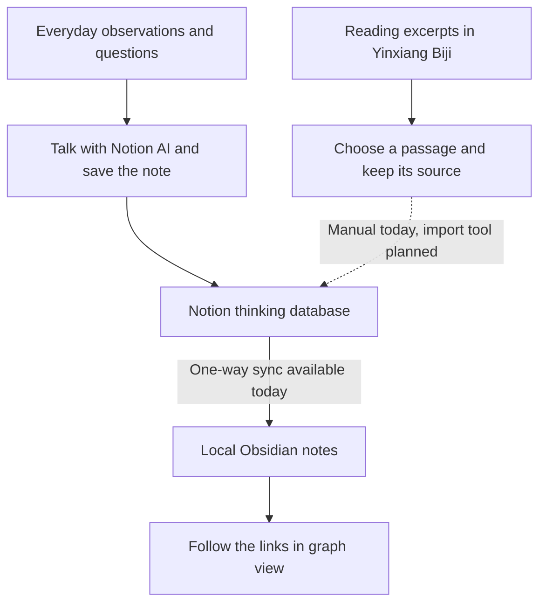
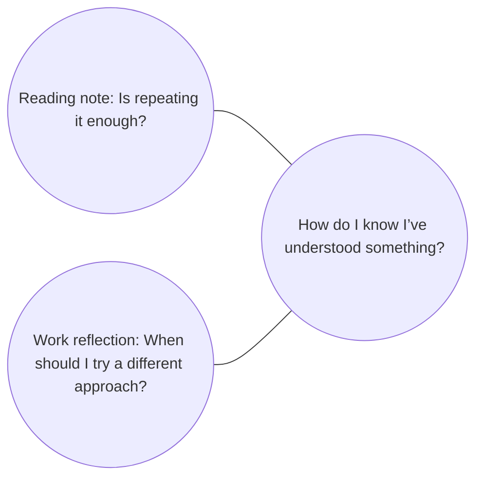

# Personal Knowledge Bridge

[简体中文](README.md)

This is a note-taking workflow I’m building for myself. I use Notion to record questions that come up during the day, Yinxiang Biji (印象笔记) to save passages from books, and Obsidian to revisit the links between my notes. The problem is simple. When I read something that sheds light on a question I had at work weeks ago, I want to find that earlier note and add what I think now.

## How I take notes

**Notion is where I keep my own thoughts.** When I have a question or want to reflect on something I’ve just done, I start with a conversation in Notion. The AI helps me separate what I observed, how I’ve come to explain it, and what I’m still unsure about. I keep my original words and can ask Notion Agent to save the organized note to a thinking database I have permission to edit. If my understanding changes, I add to the same record.

**Yinxiang Biji is where I keep reading excerpts.** Bringing a passage into Notion means choosing something I want to return to and keeping enough information to find it again, such as the book title and page number. If an excerpt reminds me of an earlier work reflection, I can link the two and add a note about what the passage made me reconsider. The original can stay in Yinxiang Biji. I can do this by hand today. An import tool is still in the design stage.

## How I revisit notes in Obsidian

When I run a sync, the script turns the records I’ve saved in Notion into local notes. It also turns shared topics and relationships I’ve recorded into Obsidian links. Graph view shows them as a network of dots and lines, a bit like a mind map. **A dot can be a note or a topic that several notes point to. A line represents a link recorded in a note.** [Obsidian graph view](https://obsidian.md/help/plugins/graph)

Say I write down a question while reading: “Does being able to repeat something mean you understand it?” Later, while training a new colleague, I notice that they remember the steps but can’t explain when to try a different approach. If I link both notes to “How do I know I’ve understood something?”, the reading note and the work reflection meet at the same point on the graph. If the graph only shows existing notes, I can create a note for that topic or adjust the graph filter.

In the full graph, I look for questions that keep coming up across different areas of my life. I can also open the local graph around one note and click through to what I wrote at the time. Reading those notes together helps me work out whether I was wrestling with the same question or just using similar words. Sometimes that’s how a few scattered observations turn into an idea I can use elsewhere.

## How to try it

Start with a few notes in a Notion database where you can create and edit entries. If your workspace has Notion AI, you can work through your ideas there. You can also use an AI tool you already know and save the result to Notion yourself. To see the notes in Obsidian, give the sync tool read access and follow the local setup guide for macOS or Linux. [Notion AI plans](https://www.notion.com/help/notion-ai-faqs) · [Notion Agent permissions](https://www.notion.com/help/notion-agent) · [Local setup guide in Chinese](docs/LOCAL_SETUP.md)

**One-way sync from Notion to local Obsidian is available today.** I still edit synced notes in Notion. Bulk import and ongoing sync from Yinxiang Biji, and writing changes back from Obsidian to Notion, are still in the design stage. [Platform status in Chinese](docs/platforms/README.md)

[Deployment environment](docs/deployment/README.md) · [Setup instructions for AI assistants](docs/ai/README.md) · [Architecture](docs/architecture/README.md) · [AGENTS.md](AGENTS.md) (in Chinese)
