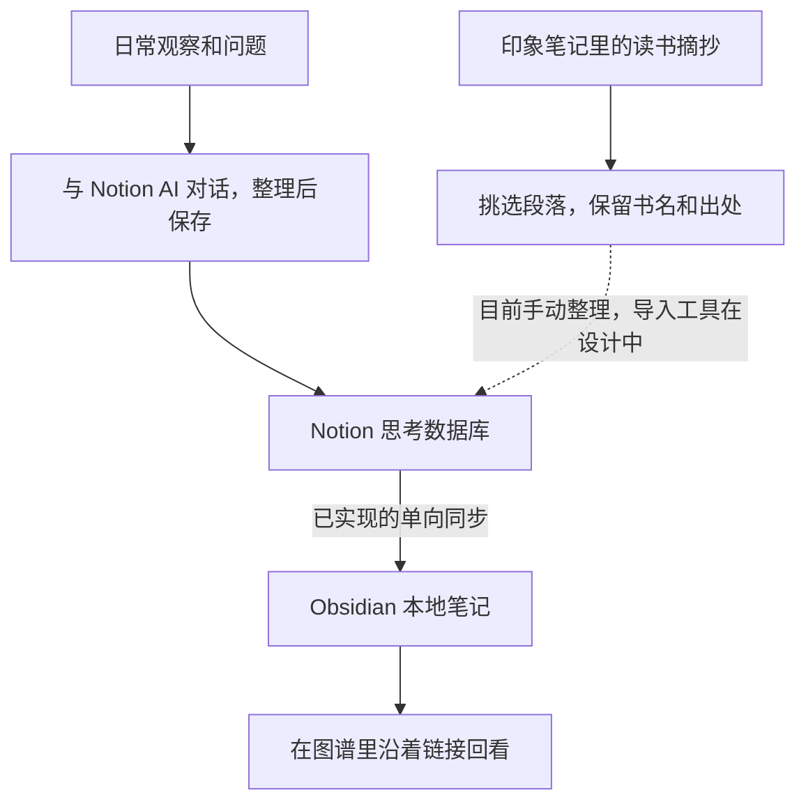
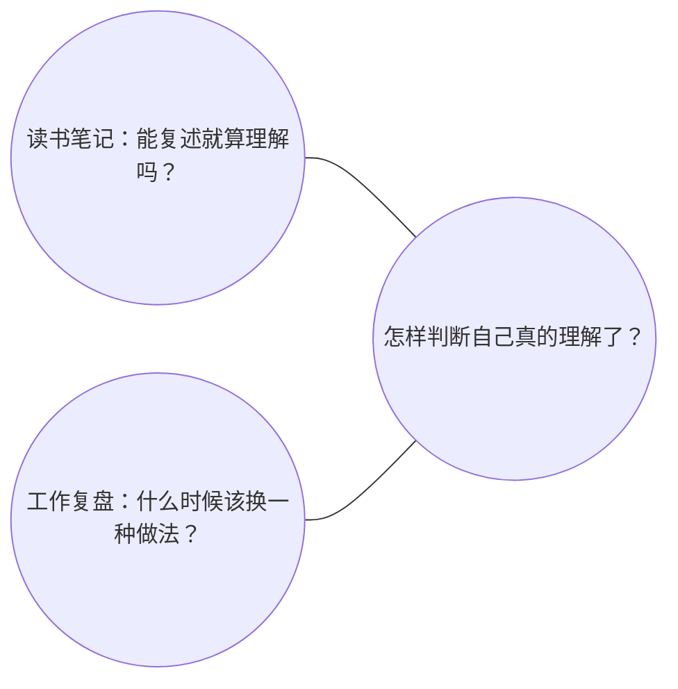

# Personal Knowledge Bridge · 个人知识库联动

[English](README.en.md)

这是我在搭建的一套个人笔记工作流。我平时用 Notion 记日常想到的问题，用印象笔记存读书时的摘抄，再用 Obsidian 回看笔记之间的联系。我想解决的是一件很普通的事：工作中遇到一个想不通的问题，后来在书里读到另一种解释，还能找到当时的记录，把新的想法补进去。

## 我平时怎么记

**Notion 放我自己的想法。** 遇到一个问题，或做完一件事想复盘，我会先在 Notion 里和 AI 聊一会儿。它帮我把当时观察到的事、后来想到的解释和还没想清楚的问题分开。我会留着自己说的原话，再请 Notion Agent 把整理好的内容存进我有编辑权限的思考数据库。以后有新的理解，我再回到那条记录里补一笔。

**印象笔记放我读到的材料。** 这里主要是读书时划下来的段落。把摘抄导入 Notion，是为了让其中用得上的段落能和自己的笔记放在一起看，同时保留书名、页码等能找到原文的信息。比如，一段摘抄让我重新想起一条工作复盘，我可以把两条记录连起来，再写下这段话让我重新考虑了什么。原件可以继续留在印象笔记里。目前可以手动整理这一步，项目里的导入工具还在设计中。

## 我怎么用 Obsidian 回看

运行同步时，脚本会把 Notion 里已经保存的记录转成本地笔记。写在记录里的共同主题，以及我确认过的笔记关联，也会变成 Obsidian 里的链接。打开图谱，就能看到这些笔记像脑图一样由点和线连在一起。**点可以是一篇笔记，也可以是几篇笔记共同指向的主题。线表示记录中留下的链接。** [Obsidian 图谱说明](https://obsidian.md/help/plugins/graph)

比如，读书时写下「能复述一段话，就算理解了吗？」，后来带新人时又记下「他记住了步骤，却说不清什么时候该换一种做法」。如果两条笔记都连到「怎样判断自己真的理解了」，它们就能在图上汇到同一个点。如果图谱只显示已有的笔记，可以给这个主题建一页，或调整图谱筛选。

看全图时，我会留意哪些问题被不同领域的笔记反复提到。也可以打开一篇笔记周围的局部图谱，点进与它相连的记录，看看自己当时是怎么想的。放在一起读过，才知道它们是在说同一件事，还是碰巧用了相似的词。几条笔记来回看过，有些原本零散的想法才慢慢有了条理。

## 怎么开始

你可以先用一个能新增和编辑条目的 Notion 数据库试几条笔记。有 Notion AI 的工作区可以在 Notion 里边聊边整理，也可以用自己习惯的 AI 聊完再手动存进去。想在 Obsidian 里回看时，按本地指南给同步工具开通读取权限，先用几条样例试跑。指南提供 macOS 和 Linux 的步骤。 [Notion AI 与套餐](https://www.notion.com/help/notion-ai-faqs) · [Notion Agent 的编辑权限](https://www.notion.com/help/notion-agent) · [本地部署指南](docs/LOCAL_SETUP.md)

目前可以从 **Notion 单向同步到本地 Obsidian**，日常更新仍在 Notion 里完成。印象笔记的批量导入与后续同步，以及从 Obsidian 写回 Notion，都在设计中。 [平台接入状态](docs/platforms/README.md)

[部署环境](docs/deployment/README.md) · [给 AI 的部署说明](docs/ai/README.md) · [架构与实现](docs/architecture/README.md) · [AGENTS.md](AGENTS.md)
