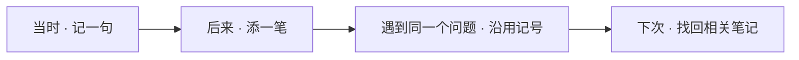
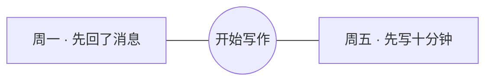

# Personal Knowledge Bridge · 个人知识库联动

**把没想完的事，留给下次接着想。**

读书时划过的一句话，开完会才冒出来的问题，散步时突然想通的一件事。先把它记下来。过几天再碰到同一个问题，你可以找回原来的想法，看看自己现在会怎么回答。

这是一套我用来整理日常思考的笔记方法，你可以照着做，也可以只借用其中一页。先试一条笔记，觉得顺手，再把自己的笔记工具连起来。

[先抄一页](#抄一页给自己用) · [把工具连起来](#把工具连起来)

## 从一本小本子开始

我想到的是一本无印良品的小记事本和一支口袋笔。正面留住当时那句话，背面写后来想通了什么，再用一个小记号，提醒自己下次从哪里翻起。

我想把这三个动作带到数字笔记里。多出来的一件事，是不同日子写下的笔记可以因为同一个问题连起来。

- **留白。** 一句话就可以停笔。还没想清楚的地方，留到下次再写。
- **正面和背面。** 原句留在前面，后来的理解另写一段。用 AI 陪自己梳理时，也留着那句自己说的话。
- **一个小记号。** 给值得回来再想的问题选一个短词。下次遇到它，就沿用这个词。笔记可以带走，记号也跟着走。

## 一条笔记怎么走



例如，周一你写下「一打开电脑我就先回消息，原本要写的东西反而没动」。周五你发现「先写十分钟再看消息，好像更容易开始」。给两条笔记都标上「开始写作」，下次想调整写作习惯时，就能把两次经验放在一起看。



## 抄一页给自己用

把下面这页复制到你已经在用的笔记里。可以只填第一行。如果一个问题反复出现，再给它一个你下次还会用的记号。

```text
当时我写下的
……

后来我想到的
……

下次想从这里找回来
……
```

可以从一条读书笔记、一段工作复盘，或今天还想再琢磨的一件小事开始。

## 把工具连起来

- **Notion 是随手写的地方。** 留住原句，有空再回来补一段。
- **Obsidian 是回头看的地方。** 把笔记留成可带走的本地文件，沿着同一个记号看相关记录。
- **印象笔记是旧资料的入口。** 从已有笔记和剪藏里挑出还想回看的内容，整理时保留出处。

目前可以把 Notion 笔记同步到 Obsidian。印象笔记导入和 Obsidian 写回 Notion 仍在设计中。[查看各平台的接入状态](docs/platforms/README.md)

这个仓库提供可复用的连接脚本和部署指南。AI 编程工具从 [AGENTS.md](AGENTS.md) 进入，再按 [AI 部署入口](docs/ai/README.md) 选择任务、填写配置并验证结果。每次部署使用自己指定的账户和数据目录，私人笔记留在自己的笔记库里。

手动体验可先用隔离样例运行 [Notion → Obsidian 同步](docs/LOCAL_SETUP.md) 或 [阅读摘录 OCR 校对](docs/platforms/READING_OCR.md)。

[部署环境](docs/deployment/README.md) · [架构与实现](docs/architecture/README.md)
